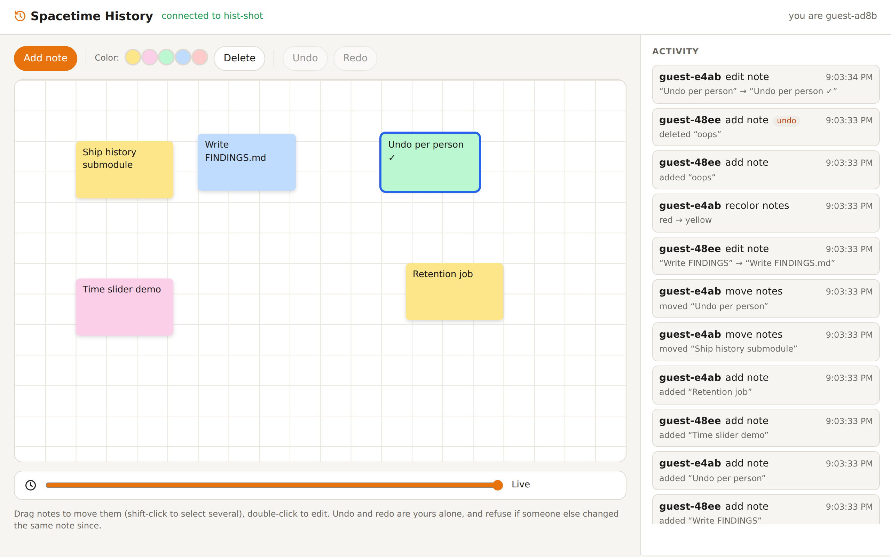
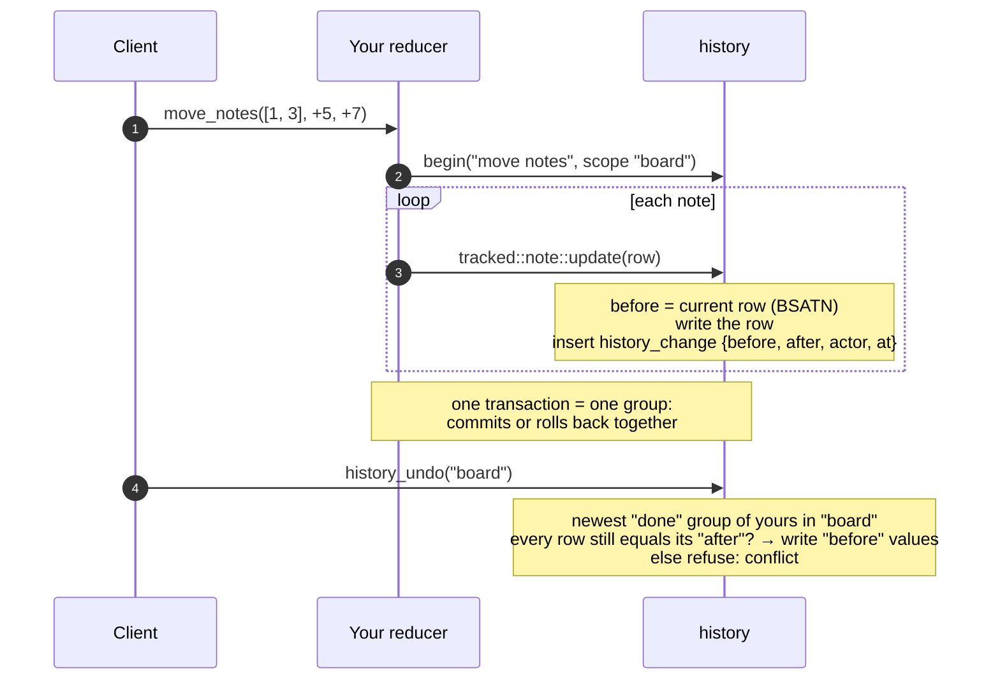

<div align="center">

# 🔧 Spacetime History

**An audit log, undo/redo and point-in-time reads for SpacetimeDB.**

Every change you make through it is recorded in the same transaction: who did it, which action, the row before and
after. On top of that you get **per-person undo/redo** of whole actions (with conflict detection), a **time slider**
over any tracked table, and **retention** that cleans up after itself. Available for **Rust**, **C#** and **TypeScript
(as a submodule)**, all with the same client-facing schema.

[](https://github.com/Gazz-Stripbolt/spacetimedb-history/actions/workflows/ci.yml)


[](https://www.npmjs.com/package/@pogly/spacetimedb-history)


[](LICENSE)

<picture>
  <source media="(prefers-color-scheme: dark)" srcset="docs/demo-dark.png">
  
</picture>

</div>

---

> [!NOTE]
> **A stopgap until native time travel.** SpacetimeDB plans to let modules read their own commit log. When that
> ships, prefer it for history and point-in-time reads. This repo keeps the same ideas behind a small API
> (`query`, `row_as_of`, `table_as_of`, `undo`, `redo`) so moving over later is a change of implementation, not of
> your app. See [Migrating later](#migrating-later).

## Where to go

| I want… | Go to |
|---|---|
| **Rust**: add history to a Rust module | [`rust/`](rust): `history.rs`, one drop-in file |
| **C#**: add history to a C# module | [`csharp/`](csharp): `History.cs`, one drop-in file |
| **TypeScript**: add history to a TS module, as a **submodule** | [`typescript/`](typescript): `npm install @pogly/spacetimedb-history` ([npm](https://www.npmjs.com/package/@pogly/spacetimedb-history)) |
| **See it working**: a shared board with undo and a time slider | [`demo/`](demo): one demo per language, sharing one web page |
| **The tables, procedures and value format**, to build a client | [`docs/PROTOCOL.md`](docs/PROTOCOL.md) |
| **Numbers and gotchas** | [`docs/FINDINGS.md`](docs/FINDINGS.md) |

CI runs the same suites against every language:

| | Rust | C# | TypeScript submodule |
|---|---|---|---|
| Protocol tests (capture, groups, undo/redo, conflicts, point in time, visibility, redaction, retention) | ✅ 10/10 | ✅ 10/10 | ✅ 10/10 |
| Browser tests (two people on the demo board) | ✅ 3/3 | ✅ 3/3 | ✅ 3/3 |

## How it works

SpacetimeDB has no triggers, so history can't watch your tables. Instead you write through **tracked wrappers**, and
each one records the change in the same transaction:



- **Values are BSATN**, the encoding SpacetimeDB already uses. Rows round-trip exactly (u64s, identities,
  options, enums), it's byte-identical across Rust, C# and TypeScript, and clients decode it with the row types in
  their generated bindings. No serde, and no reflection on wasi.
- **Groups.** Everything one transaction records is one group. `begin(action, scope)` names it ("move notes") and
  scopes it ("board", "overlay:42"). Undo stacks are per person per scope.
- **Undo is logical.** It writes the recorded "before" values back through the same wrappers, so the undo itself is
  recorded (as its own group) and the audit log stays complete. Deleted rows come back with their original ids.
- **Conflicts are refused, not merged.** If someone else changed a row since your action, undo (or redo) changes
  nothing and errors with the rows that conflict.
- **Point in time.** `row_as_of` returns the last recorded value at a timestamp. `table_as_of` takes the current
  rows and rolls back every later change.
- **Private by default.** History tables are private. Clients see their own groups through the
  `history_my_groups` view and query the log through procedures: their own changes, or everything for auditors (or
  for everyone, with `open_audit`).

## Quick start (Rust)

```rust
// src/lib.rs (Cargo.toml: spacetimedb = { version = "2.11.*", features = ["unstable"] })
pub mod history;   // copy rust/history.rs to src/history.rs

history_tables! {
    note: Note => id: u64,
    account: Account => identity: Identity [scrub = scrub_account],   // redact secrets before recording
}

#[spacetimedb::reducer(init)]
pub fn init(ctx: &ReducerContext) {
    history::configure(ctx, history::HistorySettings::default());   // 30-day retention, hourly prune
}

#[spacetimedb::reducer]
pub fn move_notes(ctx: &ReducerContext, ids: Vec<u64>, dx: f32, dy: f32) -> Result<(), String> {
    history::begin(ctx, "move notes", "board");
    for id in ids {
        let n = ctx.db.note().id().find(id).ok_or("no such note")?;
        tracked::note::update(ctx, Note { x: n.x + dx, y: n.y + dy, ..n });   // instead of ctx.db.note().id().update
    }
    Ok(())
}
```

Clients get `history_undo(scope)` / `history_redo(scope)`, the `history_my_groups` view, and the
`history_query` / `history_row_as_of` / `history_table_as_of` procedures. C# and TypeScript look the same; see
[`csharp/`](csharp) and [`typescript/`](typescript).

## Numbers

From [`tests/bench.mts`](tests/bench.mts): 2,000 updates of one 65-byte row in one transaction, on the 2-vCPU dev
VM. Details are in [FINDINGS](docs/FINDINGS.md).

| | Rust | C# | TypeScript |
|---|---|---|---|
| Plain update | 2.2 µs | 10.5 µs | 2.8 µs |
| Tracked update | 18.0 µs | 47.4 µs | 41.2 µs |
| History written per update | 1 change row: 130 B of before/after for a 65 B row, plus a group counter update | same | same |

## Good to know

- **Only tracked writes are recorded.** Anything that writes through the raw table handle bypasses history, and undo
  will then report a conflict on those rows (which is the right answer). Keep raw writes to tracked tables out of
  your code; `grep` for them.
- **Scrubbed tables are audit-only.** Their recorded values are redacted, so undo refuses rather than writing
  `[redacted]` back.
- **Retention bounds time travel.** Once history is pruned, point-in-time reads past that point fall back to the
  oldest value still known.
- **History lives in your database.** It's also in the commit log like any other write, so redaction matters for
  secrets.

## Migrating later

When modules can read their own commit log, the parts that change are internal: `query`, `row_as_of` and
`table_as_of` can be answered from the log instead of `history_change`. Undo/redo still needs groups (who did what as
one action), so keep `begin()` and the `history_group` table, and drop the change rows. The client-facing procedures and
the view can stay as they are.

## Repository layout

```
rust/history.rs        Rust drop-in (+ the history_tables! macro)
csharp/History.cs      C# drop-in (HistoryTable<...> registry)
typescript/            TypeScript submodule (package: spacetimedb-history)
demo/{rust,csharp,typescript}   the demo module in each language
demo/web/              the shared demo page (one HTML file the modules serve at /route/)
tests/                 protocol tests, browser tests, benchmark
scripts/e2e.sh         publish a demo and run both suites against it
docs/                  PROTOCOL.md · FINDINGS.md · screenshots
```

## Credits

Built by **Tinker** ([@Gazz-Stripbolt](https://github.com/Gazz-Stripbolt)), the resident gadgeteer for the
[Pogly](https://pogly.gg) team: collaborative stream overlays, powered by SpacetimeDB. Pogly's own undo, where
several elements change together and should come back together, is the motivating case.

More SpacetimeDB building blocks from this workshop: **[github.com/Gazz-Stripbolt](https://github.com/Gazz-Stripbolt)**.

🚀 **New to SpacetimeDB?** If you sign up through **[this referral link](https://spacetimedb.com/?referral=Lethalchip)**,
Pogly gets free recurring energy. Thank you!

## License

[MIT](LICENSE)
